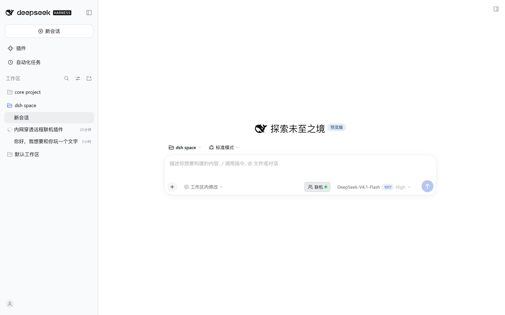
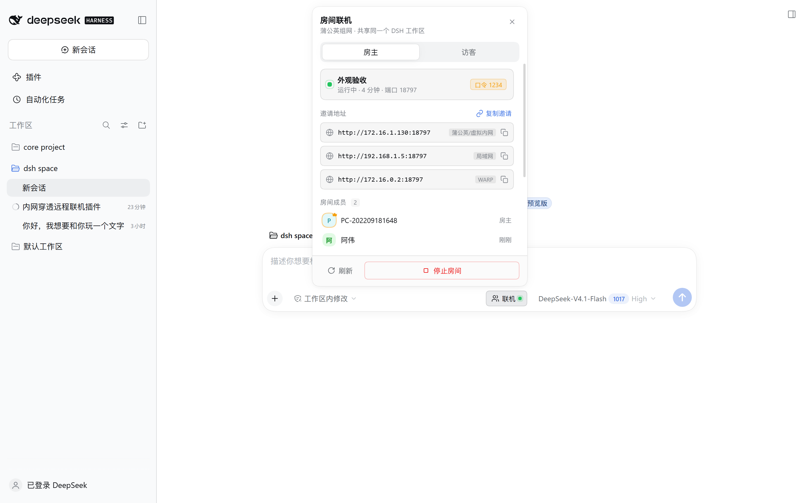
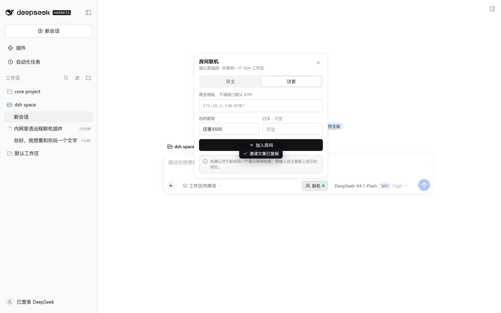
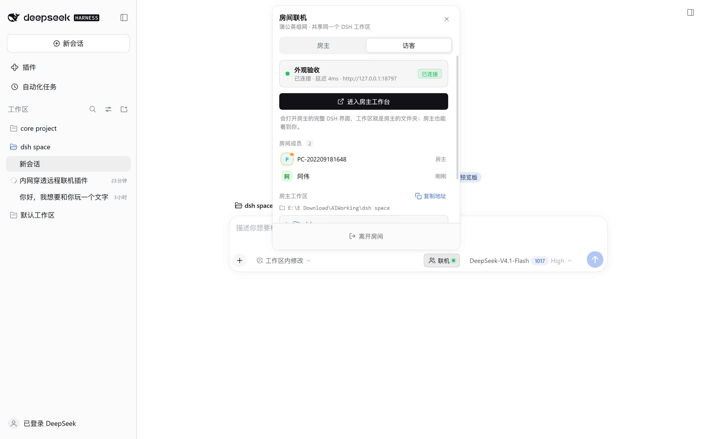
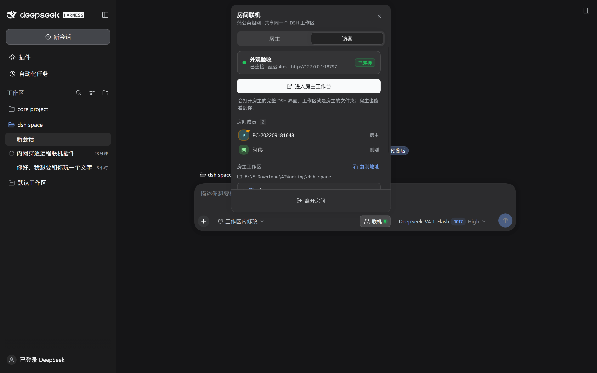

# dsh-room · 房间联机

给 DeepSeek Harness（DSH）加一个「联机」按钮：房主开房，房客在蒲公英 / ZeroTier 这类
虚拟局域网里输入 `172.16.1.130:8787`，就能进入房主的房间，看到成员、展开房主工作区，
一键打开房主的工作台（完整 DSH 界面，工作区就是房主的文件夹）。

> 一句话原理：房间代理把房客的浏览器请求改写成 loopback 再转给房主的 DSH，
> 于是 DSH 的 Host/Origin 栅栏永远看到 `127.0.0.1`，不需要改 DSH 任何配置。

## 实测状态（Windows + DSH Desktop）

在真实 Desktop 实例上跑过一遍，不是纸上设计：

- 插件热加载成功：`GET /room/api/ping` 返回 `{"ok":true,...}`
- 建房后监听 `0.0.0.0:18787`，地址列表正确识别出蒲公英的 `172.16.1.130`
- 房客握手：`GET /?token=...` → `303` + `Set-Cookie`，随后拿到真实 DSH 首页（含 `__DSH_BOOT__`）
- 首页 JS（939 KB）、插件 bundle（2.26 MB，含本插件的 `联机`）经代理均 `200`
- 加入 / 成员 / 工作区列表经代理正常；CORS 预检 `204`
- 真实 WebSocket `/api/remote.mux`：带 Cookie `101`，无 Cookie `401`
- 界面验收（无头 Chrome 经房间代理打开真实 DSH 页面）：
  - 「联机」按钮 74×28、圆角 8、字号 12，和输入框右侧其它 pill 对齐
  - 面板贴按钮向上弹出，适应可用高度（384×≤500），点外部 / `Esc` 关闭
  - 浅色 / 深色都直接吃 DSH 的 `--dsw-alias-*` token（面板 `bg-layer-2`、
    选中 tab `bg-layer-1` + `elevation-soft`），不写死颜色
  - 访客加入后显示延迟（实测 4–7ms）、成员、工作区；复制邀请有 toast

### 手机浏览器验收（2026-10-18，无头 Chrome 移动仿真 46 项全过）

用 iPhone 17.5 UA + 触摸仿真，在 390×844 / 375×667 / 430×932 / 844×390 四个视口
经真实房间代理打开 `http://172.16.1.130:8787/`：

- 手机直达房主工作台：视口 `width=device-width`、无横向溢出、`__DSH_BOOT__` 正常
- iOS Safari 的 Cookie 语义在 Chrome 上一致成立：`303` + `Set-Cookie`（`HttpOnly; SameSite=Strict;
  Max-Age=2592000`，代理已剥掉 loopback `Domain` 与 `Secure`），Cookie 落到 `172.16.1.130` 主机名下
- 访客自动加入：手机打开即出现在成员列表，面板自动摊开落在「访客」页签，
  显示「你已经在房间里了」，不再展示房主专属的 403 报错
- 面板在四个视口都不越界；视口高度从 844 收到 750（模拟地址栏出现）后仍贴合
- 触屏：`hover:none` 生效，tab 32px、关闭按钮 32×32、联机按钮 78×32
- 非 HTTPS 下 `navigator.clipboard` 不存在，`execCommand('copy')` 也失败时
  会自动弹出「长按选择复制」面板（实测弹出且文字已选中）
- 掉线自动重入：服务端清掉成员后（等价于切后台超时），派发 `visibilitychange` /
  `pageshow` 回到前台 → 客户端 401 后自动换新令牌重新入房，房主名单和手机端成员数恢复


---

## 功能

| 能力 | 房主 | 房客 |
| --- | --- | --- |
| 开房 / 关房 | ✅ 面板一键 | — |
| 输入 `IP:端口` 加入 | — | ✅ 一个输入框 |
| 房间成员列表 | ✅ | ✅ |
| 展开房主工作区 | ✅ | ✅（只读列表） |
| 打开房主工作台 | ✅ 本机 | ✅ 新标签页，完整操控 |
| 房间口令（可选） | ✅ | ✅ |
| 邀请文案一键复制 | ✅ | — |
| 手机浏览器直接加入 | — | ✅ 打开地址即自动加入（免装插件） |
| 成员踢出（仅房间面板） | ✅ | — |
| 延迟 / 运行时长显示 | ✅ 运行时长 | ✅ ping 延迟 |
| 蒲公英虚拟网卡识别 | ✅ 自动优先展示 172.16/12 地址 | — |

房间成员共享的是**房主同一个 DSH 进程**：同一批会话、同一个工作区。
这不是“同步文件夹”，而是“同一块白板”。

---

## 界面与交互

「联机」按钮直接长在输入框右侧，尺寸 / 边框 / 圆角和 DSH 自己的 pill 一致，
房间开着时按钮上有一颗绿色状态点：



点开后，面板贴着按钮向上弹出；点面板外部或按 `Esc` 关闭，浅色 / 深色跟随 DSH 主题：









细节：

- 分段 tab 用 DSH 同款滑块（`bg-layer-1` + `elevation-soft`，0.16s 位移），
  不是自己画的“选中块”
- 地址按「蒲公英 > 其它虚拟局域网 > 172.16/12 内网 > 局域网 > WARP/容器网卡」排序，
  WARP 排最后，避免把朋友连不上的地址发出去
- 成员头像按名字生成稳定色相；房主带王冠；房主悬停成员可踢出
- 复制地址 / 复制邀请 / 加入成功都有 toast 反馈
- 房主面板显示运行时长与端口；访客面板显示 ping 延迟
- 系统开启「减少动态效果」时关闭动画；触屏（`hover:none`）上踢人按钮常显
- 面板高度按输入框上方可用空间自动收紧，不会顶出屏幕
- 手机上（≤560px）面板变成贴底的卡片：高度用 `100dvh`，iOS 地址栏收放不会把面板
  顶到栏下面；触屏上按钮放大到 32px，输入框字号抬到 16px（否则 iOS 聚焦时会强制放大页面）
- 非 HTTPS 下浏览器不给自动复制，复制失败会摊开文字让你长按复制，而不是假装成功
- 手机从房主地址打开会自动以访客身份加入，面板默认停在「访客」页签

---

## 前置条件

1. **组网**：双方安装蒲公英（或 ZeroTier / Tailscale），加入同一个网络，
   确认房主能被 ping 通，例如 `ping 172.16.1.130`。
2. **DSH**：双方都安装本插件（房客只装面板也可以，直接开浏览器访问则不用装）。
3. **Desktop 版**：房主需要在 DSH 设置里允许「浏览器访问」。若没有打开，
   房客打开房间地址会看到一段中文提示页，按提示开启即可。
4. **防火墙**：房主首次开房时，Windows 会弹入站规则，允许 `8787` 端口的专用网络访问。
   没弹的话手动加一条：
   ```powershell
   New-NetFirewallRule -DisplayName "DSH Room 8787" -Direction Inbound -Protocol TCP -LocalPort 8787 -Action Allow
   ```

---

## 安装

### 方式 A：一键脚本（推荐）

在仓库根目录（`dsh-room` 的上一级）打开 PowerShell：

```powershell
powershell -ExecutionPolicy Bypass -File .\dsh-room\install.ps1
```

脚本会：

- 把 `dsh-room` 复制到 `%USERPROFILE%\.dsh\profiles\desktop\node_modules\dsh-room`
- 备份并追加 `cordis.patch.yml` 的挂载项
- 打印重启提示

然后**完全退出并重启 DSH**（托盘退出，不是关窗口）。
如果只是想让新装/更新后的插件生效：宿主插件会在 patch 变化时热加载，
通常**刷新一下 DSH 窗口（Ctrl+R）**就能看到「联机」按钮；重启最稳妥。

### 方式 B：手动

```powershell
$dst = "$env:USERPROFILE\.dsh\profiles\desktop\node_modules\dsh-room"
Copy-Item -Recurse -Force ".\dsh-room" $dst
```

在 `%USERPROFILE%\.dsh\profiles\desktop\cordis.patch.yml` 末尾追加：

```yaml
- insert:
    - id: dsh-room
      name: dsh-room
```

重启 DSH。

> 为什么桌面版不能 `dsh plugin add`：`desktop` 是 Desktop 保留的 profile，
> `dsh plugin --profile desktop ...` 会拒绝插件操作，所以只能复制 + 写 patch。
> 如果你用的是命令行/web profile，更正规的做法是：
> `dsh plugin --profile <名字> add .\dsh-room`（它会自动写依赖、bundles 和层）。
> 注意插件管理器（pnpm）可能清理手工复制的目录，更新插件后重跑一次安装脚本即可。

### 验证装上了

打开任意会话，输入框右侧出现「● 联机」按钮即成功。
若没出现，看 `%USERPROFILE%\.dsh\profiles\desktop\.plugin-manager\logs` 或 DSH 日志里
有没有 `[dsh-room]` 开头的行。

---

## 使用

### 房主

1. 点输入框右侧「联机」→「房主」。
2. 选工作区、端口（默认 `8787`）、房间名，口令可留空。
   工作区可以直接从下拉里选，也可以自己填绝对路径。
3. 点「创建房间」。
4. 面板会列出本机地址，优先显示蒲公英的 `172.16.x.x`。点一下即可复制；
   点「复制邀请」会连房间名、地址、口令一起复制成一段可以直接发给朋友的话。
5. 把地址发给朋友。

### 房客

**手机 / 平板（推荐，不用装插件）**

1. 在浏览器里打开房主给的地址，例如 `http://172.16.1.130:8787/`。
2. 代理会自动完成登录握手。手机上会自动以访客身份加入房间，并摊开「联机」面板：
   房间名、成员、房主工作区目录都在这一屏。
3. 关掉面板就是房主的工作台（DSH 网页版），可以正常对话、看文件。
   输入框右侧「联机」随时能再打开面板。

**电脑上装了插件**

1. 点「联机」→「访客」。
2. 输入 `172.16.1.130:8787`（不写端口默认 8787），可选昵称 / 口令。
3. 点「加入房间」。
4. 加入后能看到成员、展开房主工作区的目录树。
5. 点「进入房主工作台」会在新标签页打开房主的完整 DSH 界面。

> 房客不装插件也能玩：直接在浏览器打开 `http://172.16.1.130:8787/`，
> 代理会自动完成登录握手。插件只是把这件事变简单，并加了成员 / 工作区面板。

---

## 它是怎么工作的

```
房客浏览器 ──► 172.16.1.130:8787（房间代理，0.0.0.0）
                    │  Host/Origin → 127.0.0.1:<DSH 端口>
                    │  HTTP + WebSocket 全透传
                    ▼
              127.0.0.1:<DSH 端口>（房主的 DSH Web）
```

- 代理监听 `0.0.0.0:8787`，把 `Host` / `Origin` / `Referer` / `Sec-Fetch-Site`
  改写成 loopback，DSH 的信任栅栏因此放行。
- 房客没有 DSH 的会话 cookie：代理在首页导航时补上
  `?token=<本次进程启动令牌>`（来自 `ctx.connection.authenticatedUrl`），
  DSH 用 303 + `Set-Cookie` 完成登录，之后靠 cookie。
- 房间 API 由宿主插件的 `/room/api/*` 路由提供，CORS 只放行必要的头。
- `/room/api/host/*` 是房主专用接口，代理会拒绝来自非 loopback 的请求。

---

## 安全边界（请务必读）

- **房间成员 = 你本人权限的 shell。** DSH 没有多租户 / 角色 / 只读模式。
  能进房间的人就能在房主机器上执行命令、读写文件。
- 蒲公英网络本身就是第一道门。**不要把 8787 映射到公网**，也不要在不可信的
  公共组网里开房。
- 建议设置房间口令；口令只防误入，不防同网络内的恶意成员。
- 房主随时可以「停止房间」，所有房客立即断开。
- **停止房间不会撤销已经登录过的房客。** 房客首次打开工作台时拿到的是 DSH 的
  会话 Cookie（按主机名保存，不区分端口），所以停房后他们刷新仍可能进来。
  要真正断干净：停止房间 + 完全重启 DSH（进程令牌轮换），或把对方移出组网。
- 「踢出」只会删掉房间面板里的成员记录，不能撤销上面的 Cookie；不要把它当权限系统。
- 工具审批弹窗出现在房主（以及共享同一界面的房客）的界面上，看到弹窗请确认来源。

---

## 排障

| 现象 | 处理 |
| --- | --- |
| 访客点加入提示“连不上” | 先 `ping 172.16.1.130`；确认房主面板显示的房间端口；确认防火墙放行 |
| 访客打开工作台看到“需要允许浏览器访问” | 房主在 DSH Desktop 设置里开启浏览器访问 |
| 访客打开工作台看到“没有保存登录 Cookie” | 关掉无痕模式 / 允许站点 Cookie / 换浏览器；刚连续刷新过就等 1 分钟 |
| 访客看到“房主这边拿不到登录令牌” | 房主的 DSH 没有暴露 `connection.authenticatedUrl`，升级 DSH 或改用带 Web 端的新版本 |
| 手机打开后没自动加入房间 | 房间设了口令时不会自动猜；点输入框右侧「联机」→「访客」，地址已预填，填口令加入 |
| 手机切后台一会儿，房主名单里就看不到自己 / 手机面板成员变 0 | 旧版本问题；新版有心跳保活 + 回前台自动重入（服务端 120 秒才清理）。刷新页面并重启 DSH 后生效 |
| 手机上点「复制邀请」没反应 | 非 HTTPS 浏览器禁止自动复制，会弹出文字面板，长按全选复制即可 |
| 手机面板被地址栏挡住一半 | 旧版本问题；新版本面板用 `100dvh` 限高，刷新页面即可 |
| 局域网 `http://192.168.x.x:8787` 能开，手机走蒲公英 `172.16.x.x` 却一直「连接超时」 | 先查房主电脑上的 **Cloudflare WARP**：它占 `172.16.0.2/32`，和蒲公英的 `172.16.0.0/22` 撞段，会抢走回包。联机时断开 WARP（或在 Zero Trust 的 Split Tunnel 里排除 `172.16.0.0/22`），再重试 |
| 手机走蒲公英超时、且没有 WARP | 确认两端蒲公英都在线且在同一网络；看房主防火墙是否放行 8787（公用网络 profile）；再确认手机输的是 `http://`（Safari 可能自动跳 https） |
| 端口 8787 被占用 | 面板会自动顺延到 8788…；也可以手动改端口 |
| 房主面板一直“正在读取本机状态” | 重启 DSH；看日志里是否有 `[dsh-room]` 报错 |
| 访客看到的是自己的界面 | 地址写成了 `127.0.0.1`，改成房主的蒲公英 IP |
| 装完按钮没出现 | 确认 `node_modules\dsh-room` 存在、patch 已追加、DSH 完全重启 |
| 想换端口 | 房主面板停止房间 → 改端口 → 重新创建 |

---

## 卸载

1. 房主面板「停止房间」。
2. 删除 `%USERPROFILE%\.dsh\profiles\desktop\node_modules\dsh-room`。
3. 从 `cordis.patch.yml` 删掉 `dsh-room` 的 `insert` 块。
4. 重启 DSH。

或运行：

```powershell
powershell -ExecutionPolicy Bypass -File .\dsh-room\install.ps1 -Uninstall
```

---

## 已知限制

- 房客的「工作区」是**只读目录列表**，不是文件内容预览；真正的读写要在房主工作台里做。
- 多人共享同一个 DSH 进程：会话列表、消息流是共享的，没有独立座位。
- 不支持公网穿透自带域名；它设计给“已经组好网”的场景（蒲公英 / ZeroTier / Tailscale）。
- 依赖 DSH 的 `ctx.webServer` 与 `ctx.connection`；未来 DSH 大版本若改接口，需要跟着改。
- **手机只能用 http**：不套 HTTPS 时 `navigator.clipboard` 不存在，复制只能走长按兜底；
  同理也没有 Service Worker / PWA 安装能力。想更接近原生体验，需要自己加一层 HTTPS
  反代（证书得被手机信任），超过本插件范围。
- **iOS 的 Cookie 依赖站点设置**：Safari 的「无痕浏览」「阻止所有 Cookie」「跨站跟踪
  防护」会拒绝 `Set-Cookie`，房客会反复落到「浏览器没有保存登录 Cookie」提示页。
  同一来源 IP 2 分钟内最多握手 10 次（防滥用），触发后等 1 分钟再试。
- **成员掉线与自动重入**：在线状态靠心跳维持（20 秒一次），服务端 120 秒没收到
  上报才清理。手机切到后台后浏览器会把定时器节流甚至冻结，所以切回来时客户端会立刻
  补一次心跳；如果令牌已经被清理（HTTP 401），会用原昵称静默重新入房——房主名单和
  手机面板的成员数都会自动恢复，不用手动点。
- 手机自动加入只做一次（React 开发模式会把 effect 跑两遍）；如果房客主动点了「离开房间」，
  刷新页面才会重新加入（那是主动退出，不做自动恢复）。
- 窄屏下 DSH 自身仍有少量在视口右侧之外的控件（DSH 上游布局，不是本插件产生的）；
  本插件在 375–430px 下没有越界控件。

---

## 开发

纯 ESM + 手写浏览器 bundle，无构建步骤：

```
dsh-room/
├── index.mjs              宿主：房间 API + 反代 + WebSocket 透传
├── lib/client.js          浏览器：ModuleLoader bundle（React.createElement 手写）
├── cordis.patch.yml       挂载项
├── install.ps1            安装 / 卸载脚本
├── preview/               真实页面截图 + 渲染预览
├── test/host.test.mjs     离线冒烟：假 DSH 上游 + 反代 + 加入/列表/WS + 握手频控页
├── test/client.test.mjs   离线冒烟：bundle 注册 + 各视图渲染 + 复制/预填逻辑
├── test/render-preview.mjs 用真实 bundle 生成 preview/rendered.html
├── test/live-ui.mjs       真浏览器验收（CDP：按钮/面板/tab/深色/toast）
├── test/mobile-ui.mjs     手机验收（CDP 移动仿真：视口/Cookie/触屏/剪贴板/dvh）
└── README.md
```

改 `lib/client.js` 后刷新页面即可；改 `index.mjs` 需要重载插件或重启 DSH。

离线自测（不需要 DSH，也不需要浏览器）：

```powershell
node test/host.test.mjs
node test/client.test.mjs
node test/render-preview.mjs
```

手机验收（需要先开一个房间）：

```powershell
node test/mobile-ui.mjs http://172.16.1.130:8787/ preview/mobile
```

它自己拉起无头 Chrome（移动仿真 + iPhone UA + 触摸），在 390×844 / 375×667 /
430×932 / 横屏四个视口截图并断言 46 项；结果写进 `preview/mobile/report.json`，
截图是 `preview/mobile/*.png`。

真浏览器验收（需要先开一个房间，并用调试端口启动 Chrome）：

```powershell
chrome --headless=new --remote-debugging-port=9334 --user-data-dir=$env:TEMP\dsh-ui about:blank
node test/live-ui.mjs 9334 http://127.0.0.1:8787/ preview 房间口令
```
